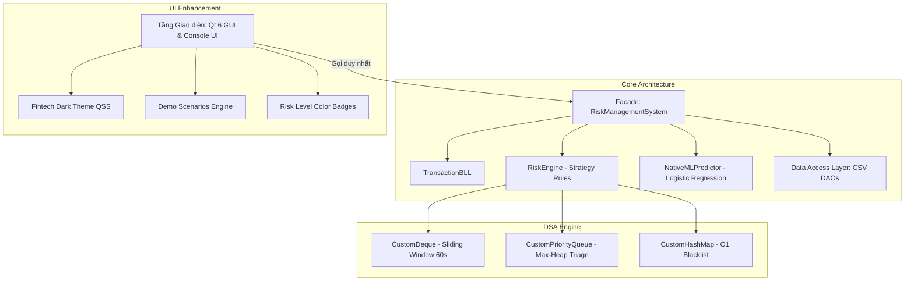

# KẾ HOẠCH NÂNG CẤP VÀ TỐI ƯU HÓA DỰ ÁN EPFD-RAS
> **Dự án**: Electronic Payment Fraud Detection & Risk Management System (`EPFD-RAS`)  
> **Mục tiêu**: Nâng cấp toàn diện kiến trúc, trải nghiệm người dùng (UI/UX) và tính thuyết phục khi báo cáo đồ án PBL 2, học hỏi từ các điểm mạnh của `PBL2-MusicPlayer` nhưng vẫn giữ vững bản sắc kỹ thuật chuyên sâu.

---

## 1. Mục tiêu & Định vị chiến lược

| Yếu tố | Hiện trạng | Sau khi nâng cấp | Lợi ích cho buổi bảo vệ |
| :--- | :--- | :--- | :--- |
| **Giao diện (UI/UX)** | Style mặc định (Fusion), các nút vuông, bảng dữ liệu đơn thuần. | **Fintech Dark Theme (QSS)** hiện đại; bảng màu cảnh báo rủi ro trực quan (Xanh/Vàng/Đỏ); Huy hiệu trạng thái (Badges). | Gây ấn tượng thị giác mạnh mẽ ngay từ 30 giây đầu tiên demo cho hội đồng. |
| **Kiến trúc phần mềm** | Tầng UI trực tiếp gọi nhiều DAO và BLL riêng lẻ. | Áp dụng **Facade Pattern** (`RiskManagementSystem`), đóng gói toàn bộ BLL và DAL làm đầu mối duy nhất cho UI. | Đạt điểm tuyệt đối về tính đóng gói và chuẩn kỹ nghệ phần mềm (Software Engineering). |
| **Kịch bản Demo** | Nhập liệu thủ công từng trường để kiểm tra. | Tích hợp **Thanh công cụ Kịch bản mẫu (Scenario-Driven Demo)** với 3 nút bấm kích hoạt tức thì. | Thầy cô thấy rõ ràng 100% thuật toán `CustomDeque` (Sliding Window), `CustomPriorityQueue` (Max-Heap) và Machine Learning hoạt động. |
| **Phản hồi người dùng** | Hộp thoại thông báo `QMessageBox` tĩnh. | **Toast Notification** trượt mượt mà và Bảng phân tích trọng số rủi ro động (**Risk Breakdown Panel**). | Trải nghiệm mượt mà, chuyên nghiệp như phần mềm ngân hàng thương mại. |

---

## 2. Bốn Trụ cột cải tiến chi tiết



---

### Trụ cột 1: Kiến trúc Facade Pattern (`RiskManagementSystem`)

#### Hiện trạng:
Lớp `MainWindow` và `ConsoleUI` hiện đang phải tự khởi tạo và giữ liên kết tới:
- `AccountDAL`
- `CardDAL`
- `MerchantDAL`
- `TransactionDAL`
- `TransactionBLL`

#### Thiết kế cải tiến:
Xây dựng lớp **`RiskManagementSystem`** (nằm trong `include/bll/RiskManagementSystem.h` và `sources/bll/RiskManagementSystem.cpp`) theo mẫu thiết kế **Facade**:

```cpp
class RiskManagementSystem {
private:
    std::string dataDir;
    std::unique_ptr<AccountDAL> accountDAL;
    std::unique_ptr<CardDAL> cardDAL;
    std::unique_ptr<MerchantDAL> merchantDAL;
    std::unique_ptr<TransactionDAL> transactionDAL;
    std::unique_ptr<TransactionBLL> transactionBLL;

public:
    explicit RiskManagementSystem(const std::string& dataDirectory);
    bool initialize(); // Nạp dữ liệu tự động từ các file CSV
    
    // API tinh gọn cho tầng UI:
    FraudEvaluationResult processTransaction(const Transaction& tx);
    std::vector<Transaction> getAllTransactions() const;
    std::vector<Transaction> getHighRiskQueue(); // Rút từ PriorityQueue
    bool blockCard(const std::string& cardNumber);
    bool authenticateAdmin(const std::string& username, const std::string& password);
};
```
* **Lợi ích**: Tầng UI chỉ cần giữ đúng một tham chiếu `RiskManagementSystem& system`, giảm triệt để mức độ phụ thuộc (loose coupling).

---

### Trụ cột 2: Giao diện trực quan Fintech Dark Theme (QSS)

Tạo một tệp stylesheet tập trung `include/ui/Theme.h` định nghĩa ngôn ngữ thiết kế **Fintech / Cyber Security Monitoring**:

#### 1. Bảng màu chủ đạo:
- **Nền chính (Background)**: `#0b0f19` (Đen Navy sâu)
- **Nền thẻ/bảng (Card/Surface)**: `#111827` (Xanh than đậm)
- **Đường viền (Border)**: `#1f2937`
- **Màu chữ chính**: `#f9fafb` (Trắng sáng), **Chữ phụ**: `#9ca3af` (Xám bạc)
- **Màu nhấn (Accent Brand)**: `#0ea5e9` (Xanh công nghệ / Electric Blue)

#### 2. Hệ thống mã màu cảnh báo rủi ro (Risk Alert Colors):
- 🟢 **APPROVED / LOW RISK** (0 - 30 điểm): Nền `#064e3b`, chữ `#34d399` (Xanh ngọc lục bảo)
- 🟡 **REVIEW / MEDIUM RISK** (31 - 70 điểm): Nền `#78350f`, chữ `#fbbf24` (Hổ phách cảnh báo)
- 🔴 **FRAUD DETECTED / HIGH RISK** (71 - 100 điểm): Nền `#7f1d1d`, chữ `#f87171` (Đỏ ruby khẩn cấp)

#### 3. Quy chuẩn trực quan:
- Mọi nút bấm (`QPushButton`), ô nhập (`QLineEdit`), bảng (`QTableWidget`) được bo góc chuẩn `border-radius: 6px;`.
- Bảng giao dịch được phân cách dòng chẵn/lẻ (`alternate-background-color`), hiệu ứng di chuột chuyển màu nhẹ nhàng.
- Thêm các **Huy hiệu trạng thái (Badges)** dạng viên thuốc (Pill shape) cho cột Kết quả thẩm định.

---

### Trụ cột 3: Thanh công cụ Kịch bản Demo thực chiến (Scenario-Driven Demo)

Để gây ấn tượng tuyệt đối trong buổi bảo vệ, bổ sung một thanh công cụ **"⚡ Kịch bản Demo nhanh (Quick Demo Scenarios)"** ngay trên thanh Menu/Top bar của giao diện Qt với 3 nút bấm:

#### 1. Nút "Kịch bản 1: Giao dịch an toàn (Normal Transaction)"
- **Thao tác tự động**: Bắn giao dịch 350.000 VNĐ tại siêu thị quen thuộc vào ban ngày.
- **Kết quả hiển thị**: 
  - Risk Score = **12/100** $\rightarrow$ Trạng thái: **🟢 APPROVED**.
  - Không vi phạm luật nào trong Risk Engine.

#### 2. Nút "Kịch bản 2: Tấn công dồn dập (Velocity Attack - Sliding Window)"
- **Thao tác tự động**: Bắn liên tiếp 4 giao dịch (mỗi giao dịch 2.000.000 VNĐ) trong vòng **5 giây** từ cùng một số thẻ.
- **Kết quả hiển thị**:
  - Thuật toán **`CustomDeque` (Cửa sổ trượt 60 giây)** kích hoạt: phát hiện tần suất giao dịch vượt ngưỡng cho phép.
  - Risk Score tăng vọt lên **75/100** $\rightarrow$ Trạng thái: **🟡 FLAGGED FOR REVIEW**.
  - Chứng minh rõ ràng trước mắt thầy cô cách `CustomDeque` loại bỏ các giao dịch cũ hơn 60s và giữ lại các giao dịch trong khung thời gian hẹp.

#### 3. Nút "Kịch bản 3: Gian lận thẻ nghiêm trọng (Critical Fraud Attack)"
- **Thao tác tự động**: Bắn giao dịch 180.000.000 VNĐ lúc 03:15 sáng tại một Merchant nằm trong Blacklist hải ngoại.
- **Kết quả hiển thị**:
  - `BlacklistRule` kích hoạt (+50 điểm) + `AmountAnomalyRule` kích hoạt (+30 điểm) + `NativeMLPredictor` dự báo xác suất gian lận 96.8%.
  - Tổng Risk Score = **98/100** $\rightarrow$ Trạng thái: **🔴 FRAUD BLOCKED**.
  - Giao dịch này ngay lập tức được đẩy thẳng lên đỉnh của **`CustomPriorityQueue` (Max-Heap)** để chuyên viên thẩm định xử lý khẩn cấp.

---

### Trụ cột 4: Trực quan hóa chi tiết đánh giá (Risk Breakdown & Feedback)

1. **Bảng phân tích rủi ro (Risk Breakdown Panel)**:
   Khi nhấp vào bất kỳ giao dịch nào trong bảng, một panel bên phải sẽ hiển thị:
   - Điểm số của từng Rule:
     - *Blacklist Check*: 0đ
     - *Velocity Window (Deque)*: 40đ
     - *Amount Anomaly*: 20đ
     - *Geographic Jump*: 0đ
   - Điểm số dự đoán từ Machine Learning: **ML Score: 88.5% (High Fraud Probability)**.
   - Kết luận tổng hợp của hệ thống.
2. **Thông báo nổi (Toast Notification)**:
   Khi bấm "Khóa thẻ (Block Card)" hoặc "Duyệt giao dịch (Approve)", một thanh Toast nhỏ gọn sẽ trượt ra ở góc dưới màn hình trong 2.5 giây rồi mờ dần, tạo cảm giác mượt mà và hiện đại.

---

## 3. Những nguyên tắc "Bất di bất dịch" (Giữ vững thế mạnh)

Khi tiến hành nâng cấp, **tuyệt đối tuân thủ 2 nguyên tắc sau**:

1. **KHÔNG chuyển sang Header-Only**:
   - Tiếp tục duy trì chuẩn cấu trúc tách biệt nghiêm ngặt giữa `include/*.h` và `sources/*.cpp`.
   - Đóng gói logic lõi vào thư viện tĩnh `libepfd_core.a`. Đây là minh chứng cho năng lực lập trình hướng đối tượng và công nghệ phần mềm chuyên nghiệp.
2. **KHÔNG bỏ cơ chế Signals & Slots của Qt**:
   - Giữ nguyên `Q_OBJECT`, macro `signals:` và `slots:` chuẩn của Qt.
   - Duy trì tính an toàn luồng và đúng quy chuẩn kiến trúc Event-Driven của Qt framework.

---

## 4. Lộ trình triển khai (Implementation Roadmap)

```
[Giai đoạn 1: UI Polish (Ưu tiên cao nhất)]
  ├── Tạo Theme.h định nghĩa QSS Fintech Dark Mode
  ├── Gán QSS vào QApplication trong main_gui.cpp
  └── Thêm màu sắc cảnh báo cho bảng giao dịch (Xanh/Vàng/Đỏ)
       │
       ▼
[Giai đoạn 2: Scenario Demo Engine (Tạo đột phá trình diễn)]
  ├── Viết class DemoScenarioManager sinh dữ liệu 3 kịch bản
  └── Bổ sung 3 nút bấm "Quick Demo" trên thanh công cụ MainWindow
       │
       ▼
[Giai đoạn 3: Refactor Facade Pattern (Hoàn thiện kiến trúc)]
  ├── Hiện thực RiskManagementSystem (BLL Facade)
  └── Tái cấu trúc MainWindow & ConsoleUI gọi qua Facade
```

---
*Tài liệu này đóng vai trò là kim chỉ nam kỹ thuật cho giai đoạn hoàn thiện dự án EPFD-RAS.*
